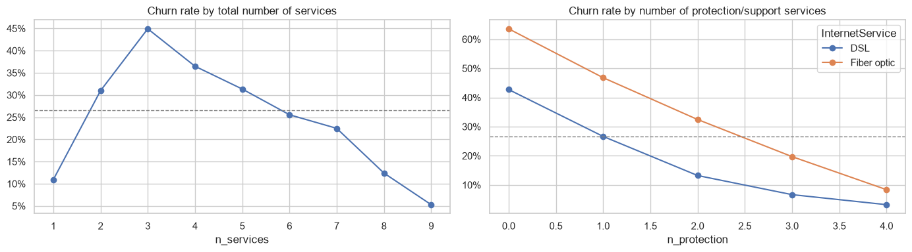
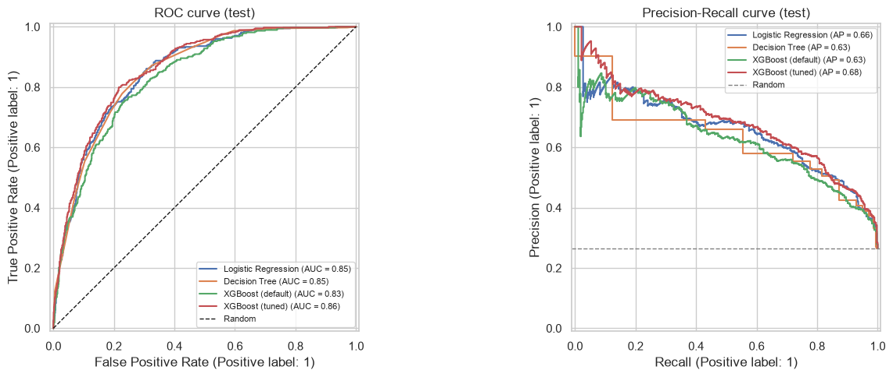
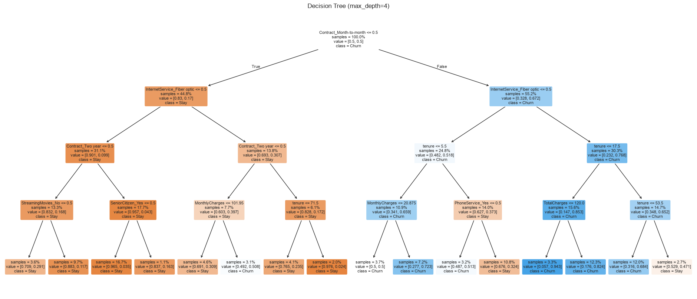
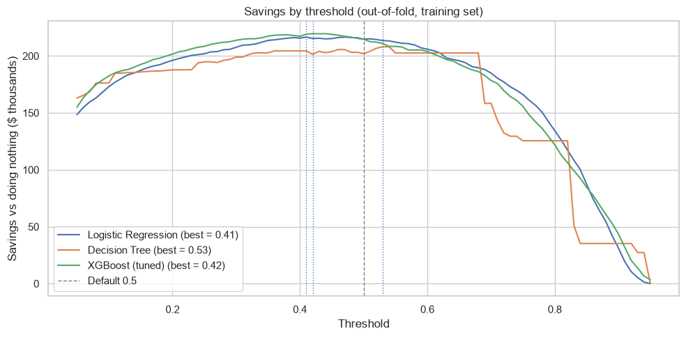
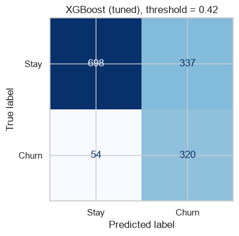

# Customer Churn Prediction with Interpretability

Predicting which telecom customers are likely to leave, explaining **why**, and
choosing whom to contact based on **business cost** rather than accuracy.


## Problem

A telecom company loses about **1 in 4 customers** (26.5% churn). The retention
team can't contact everyone, and a list of "at-risk" customers is not enough:
to act, they need to know **who** is likely to leave, **why**, and **whether
contacting them pays off**.

## Data

[Telco Customer Churn (IBM sample, via Kaggle)](https://www.kaggle.com/datasets/blastchar/telco-customer-churn):
7,043 customers, 19 features (demographics, account information and subscribed
services) and a binary target `Churn`.

The dataset is not included in this repository. Download it from Kaggle and place
it in `data/WA_Fn-UseC_-Telco-Customer-Churn.csv`.

## Key findings from the EDA

Churn is **concentrated, not spread out**:

| Who churns | Share of all churners | Churn rate |
|---|---|---|
| Month-to-month contract | 88.6% | 42.7% |
| Month-to-month, first year | **54.8%** (1,024 customers) | 51.4% |
| Electronic check payment | 57.3% | 45.3% |
| Two-year contract | 2.5% | 2.8% |

**Protection services retain customers.** Among internet customers, churn drops
from 56.7% with no protection/support service (online security, backup, device
protection, tech support) to 5.3% with all four, for both DSL and fiber.



**The fiber optic paradox.** Fiber is the most expensive internet service (median
$91.68 vs $56.15 for DSL) and concentrates 69.4% of churners. But within fiber,
customers who pay *more* churn *less*, because higher bills come from protection
services. The real risk is **fiber without add-ons**: 63.6% churn vs 8.4% with all
four protection services.

## Approach

1. **Cleaning:** `TotalCharges` stored as text; 11 blanks belong to new customers
   (`tenure = 0`) and are filled with 0.
2. **Validation:** stratified 80/20 train/test split; 5-fold stratified
   cross-validation on the training set; the test set is used only once.
3. **Preprocessing in scikit-learn pipelines** (no leakage, saved with the model):
   duplicated "No internet/phone service" levels removed, an engineered feature
   `n_protection`, and two preprocessors:
   - **Linear:** redundant features removed after a VIF check (`MonthlyCharges`
     was ~97% explained by the services), scaling and one-hot with a reference category.
   - **Tree:** all features, no scaling.
4. **Class imbalance:** `class_weight="balanced"` / `scale_pos_weight`, metrics
   suited to imbalance (PR-AUC as the main metric), and a cost-based threshold.
5. **Models:** Logistic Regression (interpretable baseline), Decision Tree
   (readable rules) and XGBoost, tuned with `RandomizedSearchCV` (50 combinations).

## Results

**Cross-validation (training set)**

| Model | ROC-AUC | PR-AUC | Recall | Precision | F1 |
|---|---|---|---|---|---|
| **XGBoost (tuned)** | **0.845** | **0.662** | **0.805** | 0.517 | **0.629** |
| Logistic Regression | 0.839 | 0.645 | 0.788 | 0.513 | 0.621 |
| XGBoost (default) | 0.813 | 0.608 | 0.654 | 0.545 | 0.594 |
| Decision Tree (depth 4) | 0.822 | 0.588 | 0.763 | 0.504 | 0.606 |
| Dummy (always "no churn") | 0.500 | 0.265 | 0.000 | 0.000 | 0.000 |

- Default XGBoost **overfit heavily** (train PR-AUC 0.979 vs 0.608 on validation).
  Tuning fixed it (0.691 vs 0.662) with very shallow trees (`max_depth=2`,
  476 trees, learning rate 0.03).
- Tuned XGBoost beats Logistic Regression in **all 5 folds** on PR-AUC. The gain is
  small (+0.017), which shows churn is driven mostly by simple, additive effects.

**Test set (1,409 customers, 374 churners, evaluated once)**

| Model | ROC-AUC | PR-AUC | Recall | Precision | F1 |
|---|---|---|---|---|---|
| **XGBoost (tuned)** | **0.862** | **0.680** | 0.824 | 0.538 | **0.651** |
| Logistic Regression | 0.853 | 0.656 | 0.794 | 0.524 | 0.631 |
| Decision Tree | 0.853 | 0.632 | 0.848 | 0.506 | 0.633 |
| XGBoost (default) | 0.834 | 0.630 | 0.684 | 0.559 | 0.615 |



## Interpretability: readable rules

A depth-4 Decision Tree finds the same drivers as the EDA without being told:
contract type first, then fiber optic, then tenure. **Four rules capture 72.9% of
all churners** in the training set, all of them month-to-month customers:

| Rule (all month-to-month) | Customers | Churners | Churn rate |
|---|---|---|---|
| Fiber + first ~1.5 years | 693 | 436 | 62.9% |
| Fiber + 1.5 to 4.5 years | 676 | 297 | 43.9% |
| No fiber + first ~6 months, above the basic plan | 406 | 197 | 48.5% |
| Fiber + brand new (total charges ≤ $120) | 187 | 160 | **85.6%** |



## Business-cost threshold

Instead of the default 0.5, the threshold is chosen by **money saved**, using each
customer's monthly charges (illustrative assumptions: $50 per retention offer,
12 months of revenue lost per churner, 30% of contacted churners retained).
It is selected on out-of-fold predictions of the training set and applied once
to the test set.



| Strategy (test set) | Savings vs doing nothing |
|---|---|
| Do nothing | $0 (lose $336,272) |
| Contact everyone | $30,432 |
| **Tuned XGBoost, threshold 0.42** | **$54,327** (16.2%) |

- **The model nearly doubles the value of a retention campaign** compared with
  contacting everyone.
- At threshold 0.42 it detects **320 of 374 churners (85.6%)**, contacting 657
  customers.
- The savings curve is **flat between ~0.35 and 0.50**: the exact threshold
  matters little.
- **The real lever is the offer's success rate:** savings range from 1.2% (10%
  success) to 34.6% (50% success).



## Error analysis

- **Missed churners look like loyal customers:** median tenure of 39 months
  (vs 7 for detected churners), 55.6% on one- or two-year contracts. Their reasons
  for leaving are not in the dataset.
- **False alarms look like churners** (88.7% month-to-month, median tenure of 16
  months): at-risk customers who stayed, at least for now.
- Improving the model needs **new information** (complaints, service calls, usage),
  not more tuning.

## Recommended actions

1. **Lock in new customers early:** incentives to move month-to-month customers to
   a one-year contract in their first months.
2. **Bundle protection services with fiber:** a free trial of tech support or
   online security for fiber customers without add-ons.
3. **Move electronic check payers to automatic payment.**
4. **Score customers monthly and measure the offer** with a control group, then
   recalibrate the threshold with the real success rate.

## Limitations

- **Association is not causation:** only an A/B test can show whether offering
  protection services or longer contracts *causes* lower churn.
- The cost figures are **illustrative assumptions**, not company data.
- About half of the contacted customers would not churn (precision 48.7%).
- The data is a **static snapshot** with no dates, usage or customer service history.

## Repository structure

```
├── data/                                   # dataset (not included, see Data)
├── images/                                 # charts used in this README
├── churn_features.py                       # feature engineering used by the pipeline
├── customersretention.ipynb                # full analysis
├── customersretention_threshold.json       # threshold, metrics and assumptions
├── requirements.txt
└── README.md
```

## How to reproduce

```bash
git clone https://github.com/silvigattino/telco-churn-interpretability.git
cd telco-churn-interpretability
python -m venv .venv
.venv\Scripts\activate          # Windows (macOS/Linux: source .venv/bin/activate)
pip install -r requirements.txt
jupyter notebook customersretention.ipynb
```

Running the notebook end to end trains the models and saves the final pipeline as
`customersretention_pipeline.joblib` (not tracked in Git).

## Next steps

- Serve the saved pipeline through a **FastAPI** endpoint that returns the churn
  probability and the contact decision.
- Add customer service and usage data to catch "loyal-looking" churners.
- Explain individual predictions with SHAP.
